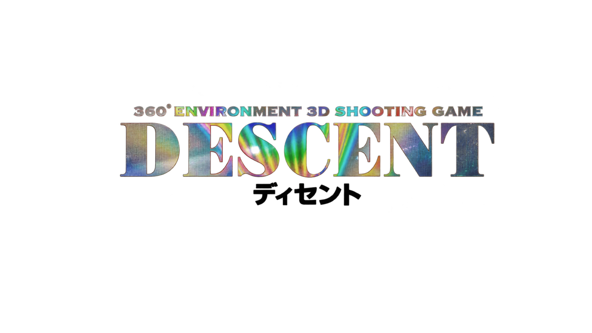
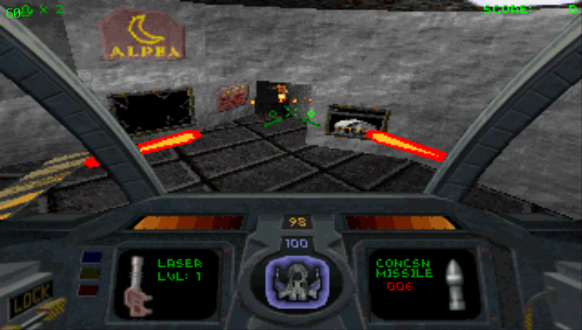
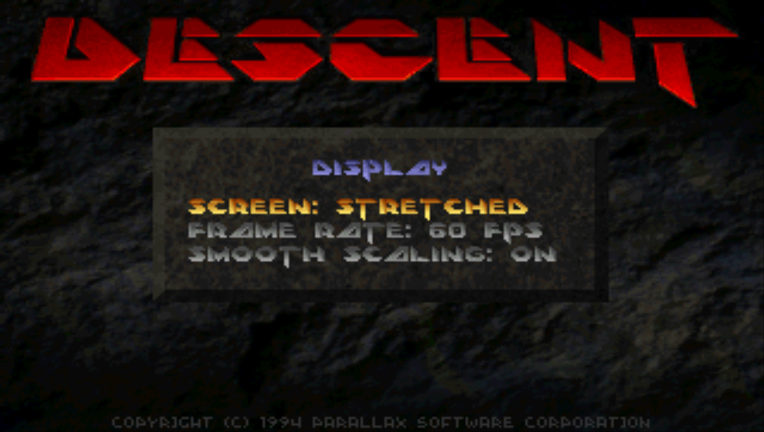
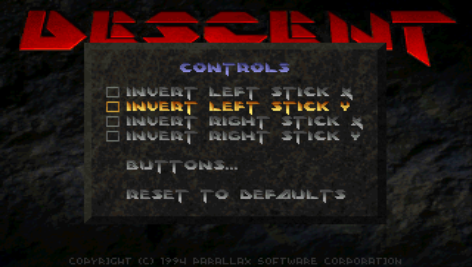

<p align="center">
  
</p>

This is a native port of **Descent (1995)** to the PlayStation Vita, based on the original Parallax Software 1.5 source release.

The port stays close to the original game, including its software renderer, which still renders at 320×200. The Vita's GPU is only used to scale the finished frame to the screen, rather than rendering the 3D graphics itself.

## Screenshots



| Display options | Controls |
| --- | --- |
|  |  |

## Required game files

This port does not include the original game data. You'll need to obtain the files from a compatible Descent release and copy them to `ux0:data/descent/`.

The following files are required:

- `descent.hog` — contains the game's levels and other game resources.
- `descent.pig` — contains the textures, graphics, and other assets needed by the game.

Both files must come from the same release. The shareware version (v1.4) and the full v1.5 release (the one sold on GOG, just copy `DESCENT.HOG` and `DESCENT.PIG` from the install folder) both work on hardware. The game checks which one you have when it starts, so the same VPK handles either.

### Music (optional)

The game data has no recorded music, only MIDI songs that DOS played through your sound card. There are two ways to get music on the Vita, and you can use either one or both. Without them the game runs fine, just silent.

**Option 1: a SoundFont (`music.sf2`).** The port plays the original MIDI songs through a SoundFont synthesizer. The one it was tested with is GeneralUser GS:

1. Go to https://github.com/mrbumpy409/GeneralUser-GS and download `GeneralUser-GS.sf2` (the file in the root of the repository, about 32 MB). Direct link: https://github.com/mrbumpy409/GeneralUser-GS/raw/main/GeneralUser-GS.sf2
2. Rename it to `music.sf2`.
3. Copy it to `ux0:data/descent/`.

Any other General MIDI SoundFont works too, as long as it's named `music.sf2`. The whole SoundFont is loaded into memory (GeneralUser GS takes about 64 MB once loaded), so much bigger ones may not fit.

**Option 2: a recorded soundtrack (`.dxa`).** The DXX-Rebirth soundtrack packs also work. They're recordings of the music played on real hardware, like the Roland SC-55 or the Sound Blaster AWE32. Download one of the Descent 1 packs (the ones starting with `d1`, or `D1X-ARACHNO.DXA`) from https://github.com/pudlez/dxx-addons/releases and copy the `.dxa` file as it is to `ux0:data/descent/`. Don't extract it, and only put one pack in the folder. A good one to start with is `d1xr-sc55-music.dxa`.

Songs that aren't in the pack fall back to the SoundFont, if you have one. Some packs (like the PlayStation and Mac CD ones) only replace some of the songs. With the shareware data, the menu, briefing and credits music comes from the pack, but the level music is named differently in the shareware, so the levels use the SoundFont.

Your directory should look like this:

```text
ux0:data/descent/
├── descent.hog
├── descent.pig
├── music.sf2                (optional)
└── d1xr-sc55-music.dxa      (optional, any one .dxa soundtrack pack)
```

Additional command-line arguments can be specified in `args.txt`, and fatal errors are logged to `error.log` in the same directory.

## Current status

The shareware version (v1.4) is fully playable and has been tested on real PS Vita hardware and runs at 60 FPS with no issues. The full game (v1.5, GOG release) also runs on hardware: all 27 levels, the secret levels and the ending have been tested. Add-on missions are still untested.
Network multiplayer isn't supported at the moment. The original game relied on IPX networking, which hasn't been implemented in this port.


## Features

The port includes both original 4:3 and stretched display modes, optional smooth scaling, and a choice between 30 and 60 FPS caps. Controls are adapted for the Vita's twin sticks, with independent axis inversion, and nearly every button can be remapped. Both halves of the rear touchpad are also configurable.

Text input uses the Vita's system keyboard, while sound effects are handled by a custom mixer and MIDI music is played through a SoundFont synthesizer, or replaced by a recorded DXX-Rebirth soundtrack pack. Pilot profiles, settings, and save files are stored alongside the game data.

## Installation

Install `Descent ディセント.vpk` using VitaShell, then copy the required game files to `ux0:data/descent/`.

You'll need `descent.hog` and `descent.pig` from either the shareware or registered release. Music is optional, see [Music](#music-optional) above for where to get `music.sf2` or a `.dxa` soundtrack pack.

You can also put additional command-line arguments in `ux0:data/descent/args.txt`. If the game encounters a fatal error, it writes the details to `ux0:data/descent/error.log`.

## Default controls

| Button | In-game action | Menu action |
| --- | --- | --- |
| Left stick | Thrust and slide left/right | |
| Right stick | Pitch and turn | |
| D-pad up/down | Slide up/down | Navigate |
| D-pad left/right | Bank | Navigate and adjust sliders |
| Cross | Select next primary weapon | Select |
| Triangle | Select next secondary weapon | |
| Square | Flare | Toggle |
| Circle | Drop bomb | Back |
| R | Fire primary weapon | Next item |
| L | Fire secondary weapon | Previous item |
| Select | Open automap | |
| Rear touchpad, left half | Rear view | |
| Rear touchpad, right half | Cockpit view | |
| Start | Pause / abort | Back |

Controls can be customized under **Options > Controls > Buttons**, except for Start.

## Building from source

You'll need [VitaSDK](https://vitasdk.org) with `vita2d` installed. From the project directory, run:

```bash
export VITASDK=/usr/local/vitasdk
export PATH=$VITASDK/bin:$PATH

cmake -S . -B build
cmake --build build
```

The build produces `build/descent.vpk`. The game is compiled twice, once for the full release (`eboot.bin`) and once for the shareware data (`shareware.bin`), since the original code picks between them at compile time. Both end up in the same VPK, and `eboot.bin` switches over to `shareware.bin` on startup when it finds the shareware `descent.pig`.

## Changes to the original DOS source

Porting the original code to the Vita required a few important changes, mostly to make it work correctly on ARM hardware.

The original x86 assembly routines for fixed-point and vector math, the 3D pipeline, texture mapping, and image blitting have been rewritten in C while preserving their original results. The DOS version also relied on Watcom's one-byte structure packing, so game tables are now read from disk field by field, allowing the port to use naturally aligned ARM structures.

The code preserves Watcom's unsigned `char` behavior where needed. DOS-specific VGA, keyboard, joystick, timer, and SOS audio functionality has been replaced with a Vita-specific layer in `VITA/`.

There are also a couple of changes to the audio pipeline. Sounds in the shareware data use 4-bit ADPCM and are decoded when loaded. Music stored in HMP format is handled by a small sequencer built around TinySoundFont.

## Credits and licensing

The original Descent source code was released by Parallax Software. See `README.TXT` for its license. Game data files are not included with this project and remain the property of their respective owners.

Music playback uses [TinySoundFont](https://github.com/schellingb/TinySoundFont) by Bernhard Schelling, under the MIT license (`VITA/TSF.H`). Recorded soundtracks are decoded with [stb_vorbis](https://github.com/nothings/stb) by Sean Barrett, public domain or MIT (`VITA/VORBIS.H`). The HMP file layout and shareware sound decoder are based on information and implementations from [DXX-Rebirth](https://github.com/dxx-rebirth/dxx-rebirth), and the `.dxa` soundtrack format comes from the same project.

Testing was also carried out with the [GeneralUser GS](https://github.com/mrbumpy409/GeneralUser-GS) SoundFont by S. Christian Collins.

Some parts of the code were written or improved with the assistance of Claude, an AI tool developed by Anthropic. AI-assisted changes were reviewed, tested, and manually validated as part of a development process that remained under human supervision.

